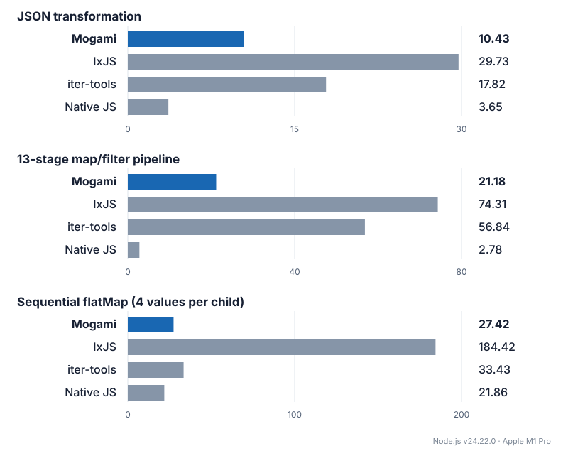

# mogami-stream

TypeScript operators for standard `AsyncIterable` pipelines, with bounded concurrency, explicit cancellation, and zero runtime dependencies.

```ts
import { from, map, rateLimit, take, toArray } from "mogami-stream";

const texts = from(urls).pipe(
  rateLimit({ count: 5, perMs: 1_000 }),
  map(
    async (url, { signal }) => {
      const response = await fetch(url, { signal });
      if (!response.ok) throw new Error(`HTTP ${response.status}`);
      return response.text();
    },
    { concurrency: 5, capacity: 5, ordered: false },
  ),
  take(20),
);

const results = await toArray(texts, { signal });
```

In the example above, `rateLimit` paces how often upstream `next()` reads start within a single pipeline execution. It does not coordinate requests across separate executions or count retry attempts inside `map`.

## Use from source

Install Node.js 22 or later and pnpm 11.1.1, then clone and build the library:

```sh
git clone https://github.com/45deg/mogami-stream.git
cd mogami-stream
pnpm install --frozen-lockfile
pnpm build
```

In another project, add the built checkout as a local dependency:

```sh
pnpm add /absolute/path/to/mogami-stream
```

The package exports the built ESM and TypeScript declarations in `dist/`. Rebuild the checkout after changing its source.

## API reference

Generate the HTML API reference from the TypeScript entry point with [TypeDoc](https://typedoc.org/):

```sh
pnpm install --frozen-lockfile
pnpm run docs
```

Then open `docs/api/index.html` in a browser. The generated reference covers all exported functions, overloads, option types, callback contexts, and `Stream` methods. Generated HTML under `docs/` is ignored by Git and excluded from the npm package.

## Execution and cleanup

Stream construction, `.pipe()`, and iterator acquisition are all lazy; execution begins on the first `next()` call. `take(0)` and already-aborted external signals finish without opening the upstream input. `from` preserves the input's replayability, whereas `defer` creates a fresh input for each execution.

```ts
import { defer, iterate } from "mogami-stream";

const source = defer(({ signal }) => openResource(signal));
const iterator = iterate(source, { signal: controller.signal });

try {
  for await (const value of iterator) {
    await consume(value);
  }
} finally {
  const report = await iterator.closed;
  // report.kind: "completed" | "cancelled" | "failed"
  // When kind is "failed" or "cancelled", report.reason holds the primary
  // error or cancellation reason.
  // report.suppressedErrors collects any additional processing or cleanup errors.
}
```

- `cancel(reason)` requests an immediate stop. Any pending `next()` call rejects right away without waiting for cleanup to finish.
- `return()` requests a stop and awaits cleanup before resolving.
- `throw(error)` stops the execution with `error` rather than forwarding it into an upstream generator's `.throw()`.
- `closed` always resolves with a `CloseReport` once teardown finishes, even if cleanup throws.

Only one `next()` call may be pending on a `StreamIterator` at a time; a concurrent call rejects with `TypeError`. A failure or cancellation rejects `next()` once, after which subsequent reads resolve to `{ done: true, value: undefined }`. Terminal consumers (`toArray`, `reduce`, `forEach`, `find`, `some`, and `every`) always wait for cleanup before settling and prioritize the primary processing error over subsequent cleanup errors.

Because JavaScript async iterators cannot forcibly preempt an arbitrary `await`, non-cooperative promises or blocked upstream reads will keep `closed`, `return()`, and terminal consumers pending until they settle. Pass the `signal` provided by `defer` and operator callbacks into external I/O APIs so cancellation can abort underlying work.

Pipelines do not insert artificial timer ticks or macrotask yields. If a synchronous source and synchronous callbacks run continuously, they can starve timers and I/O on the host event loop unless the source, callback, or consumer yields explicitly.

`take(n)` begins closing its upstream stage before delivering the `n`th value, while keeping downstream callback signals active. `finalize(effect)` runs once when a started stage closes, after its child stages and in-flight operations complete. Nested finalizers run from inner stages outward.

## Concurrency and demand

`map(mapper, { concurrency = 1, capacity = concurrency, ordered = true })` transforms items with bounded concurrency and awaits synchronous or asynchronous callback results. Each call receives `{ index, signal, attempt }`, where `index` is zero-based and `attempt` is one-based per operator execution.

Both `concurrency` and `capacity` must be positive safe integers with `capacity >= concurrency`. At any point, the sum of reserved upstream reads, running mapper calls, and completed outputs waiting for downstream delivery is at most `capacity`. A reserved upstream read also counts toward `concurrency`, and at most one upstream read is in flight at a time.

With `ordered: true` (the default), results are emitted in input order even when earlier items take longer than later ones. With `ordered: false`, results are emitted as they complete. Any unhandled mapper error stops the execution immediately, even if an earlier item is still running.

Work is driven by downstream demand: the stage pulls new inputs only while a downstream read is pending. Once a result is delivered to downstream, no further upstream reads are started until the next `next()` request (though reads and mapper calls already in flight may finish up to `capacity`). Each concurrent stage manages its own bounds independently of external source buffers or terminal collectors like `toArray`.

## Public API

All source factories and operators return a `Stream<T>`, which implements `AsyncIterable<T>` and provides `.pipe()`, `.iterate(options?)`, `.toArray(options?)`, `.reduce(reducer, initial, options?)`, `.forEach(effect, options?)`, `.find(predicate, options?)`, `.some(predicate, options?)`, and `.every(predicate, options?)`.

Every `Stream` terminal method has a standalone counterpart (`iterate`, `toArray`, `reduce`, `forEach`, `find`, `some`, `every`) that accepts any synchronous `Iterable` or `AsyncIterable`. Operators also accept arbitrary `AsyncIterable` inputs, and source/combination functions (`from`, `chain`, `merge`, `zip`, `zipLatest`) accept both `Iterable` and `AsyncIterable` inputs.

Both `.pipe(...operators)` and the standalone `pipe(source, ...operators)` infer types for up to eight operators; chain multiple `.pipe()` calls for longer pipelines. Parameterless or value-independent operators (`take`, `skip`, `chunks`, timing operators, and `finalize`) remain generic when stored in a variable, so `const first = take(1)` can be reused across streams of different element types. `chain` and `merge` infer the union of their input element types when given heterogeneous sources.

### Sources, operators, and consumers

| API                                                                       | Description                                                                                                                                               |
| ------------------------------------------------------------------------- | --------------------------------------------------------------------------------------------------------------------------------------------------------- |
| `from(source)`, `defer(({ signal }) => source)`                           | Wrap an existing iterable, or create a fresh source per execution (the factory may be async).                                                             |
| `of(...values)`, `empty()`, `range(start, end, step = 1)`                 | Create streams from values or an integer range (`end` is exclusive; bounds and nonzero `step` must be safe integers).                                     |
| `fromTimeline(events)`                                                    | Replay a scheduled sequence of values, completion, or errors for testing and mocking.                                                                     |
| `map(mapper, options?)`, `mapSettled(mapper, options?)`                   | Transform values with bounded concurrency and optional per-item retries; `mapSettled` wraps outcomes in `{ status, value \| reason }`.                    |
| `filter(predicate)`                                                       | Keep values matching a sequential sync/async predicate; synchronous type guards narrow the output type.                                                   |
| `filterMap(mapper)`                                                       | Map values sequentially and drop only `null` and `undefined` results.                                                                                     |
| `dedupe(keySelector?)`                                                    | Drop consecutive items whose keys match via `Object.is` (defaults to the item itself).                                                                    |
| `take(n)`, `skip(n)`, `takeWhile(predicate)`                              | Take a prefix, skip leading items, or take items while a predicate holds.                                                                                 |
| `skipWhile(predicate)`                                                    | Drop leading items while the predicate returns `true`, then emit the first non-matching item and all remaining items without testing again.               |
| `chunks(size)`                                                            | Group items into arrays of up to `size` elements, emitting a final smaller array on normal completion.                                                    |
| `scan(reducer, initial)`                                                  | Sequentially fold items and emit each updated accumulator value.                                                                                          |
| `chain(...sources)`                                                       | Read sources one after another, waiting for each source to close before opening the next.                                                                 |
| `merge(...sources)`                                                       | Read sources concurrently with one slot per source and round-robin selection among ready sources.                                                         |
| `zip(...sources)`                                                         | Emit tuples of corresponding items, stopping as soon as the shortest source ends and closing the rest.                                                    |
| `zipLatest(sources, { partial = false }?)`                                | Emit tuples of the latest values from each source. Waits for all sources to emit once unless `partial: true` (which fills unseen slots with `undefined`). |
| `flatten({ concurrency = 1 }?)`, `concat({ concurrency = 1 }?)`           | Flatten a stream of child sources concurrently (`flatten`) or strictly in child order (`concat`).                                                         |
| `flatMap(mapper, options?)`, `concatMap(mapper, options?)`                | Map items synchronously to child sources and flatten them; use `defer` inside the child for async setup.                                                  |
| `tap(effect)`, `finalize(effect)`                                         | Run a sequential per-item side effect, or a stage teardown callback.                                                                                      |
| `catchError(handler)`                                                     | If upstream fails, wait for its cleanup and switch once to the fallback source returned by `handler`.                                                     |
| `iterate(source, { signal }?)`                                            | Acquire a `StreamIterator` with `cancel(reason?)` and `closed`.                                                                                           |
| `toArray(source, options?)`                                               | Collect all values into an array.                                                                                                                         |
| `reduce(source, reducer, initial, options?)`                              | Sequentially fold all values into a single result, starting from `initial`.                                                                               |
| `forEach(source, effect, options?)`                                       | Run a sequential async/sync side effect for each item without collecting results.                                                                         |
| `find(source, predicate, options?)`                                       | Return the first matching item (or `undefined`), closing upstream early. Supports synchronous type guards.                                                |
| `some(source, predicate, options?)`, `every(source, predicate, options?)` | Short-circuit boolean checks that close upstream as soon as the result is determined.                                                                     |

### Behavioral notes

- **Sequential callbacks & validation**: `filter`, `filterMap`, `dedupe`, `takeWhile`, `skipWhile`, `tap`, `reduce`, `scan`, `forEach`, `find`, `some`, and `every` run their callbacks one item at a time. `take` and `skip` require non-negative safe integers, and `chunks` requires a positive safe integer; invalid counts throw `RangeError` when the operator is called.
- **`filterMap`, `dedupe`, and `skipWhile`**: Callbacks receive `{ index, signal }` (where `index` resets to `0` for each execution) and may return promises. `filterMap` drops only `null` and `undefined`, preserving `0`, `false`, and `""`. Without a `keySelector`, `dedupe` compares items directly (preserving Promise identity); with a `keySelector`, it awaits the selector result. Comparisons use `Object.is` (so `NaN` equals `NaN`, and `+0` differs from `-0`) and only check against the immediately preceding emitted key (`1, 1, 2, 1` emits `1, 2, 1`).
- **`catchError`**: Handles upstream acquisition and processing errors. The handler `(error, { signal }) => fallback` is called only after all in-flight upstream work and cleanup have finished, and may return a source or a promise of one. Execution cancellation, cleanup errors, handler errors, errors from the replacement source, and downstream errors are not caught. Place another `catchError` downstream if the fallback source itself needs recovery.

```ts
const values = from(primary).pipe(
  catchError((_error, { signal }) => openFallback(signal)),
  filterMap((value) => value.parsed),
  dedupe((value) => value.id),
  skipWhile((value) => !value.ready),
);
```

- **Higher-order and combination bounds**: In `flatten`, `concat`, `flatMap`, and `concatMap`, a child source occupies its concurrency slot from reservation until its cleanup finishes, and holds at most one pending read or buffered item. In `concat` and `concatMap`, children that finish early retain their slots until earlier children finish, preventing unbounded buffering behind a slow leading child. In `zip`, detecting that the shortest input has ended may consume one extra item from a sibling input. In `zipLatest`, multiple updates arriving before all sources have initialized may coalesce into the latest value; after initialization, reads are paced by downstream demand.
- **Promise-valued items**: If an input yields values that are themselves Promises, `from`, selection operators, and combination operators pass those Promise objects through without unwrapping them (unlike native `for await (... of syncIterable)`, which awaits each item). Only callbacks whose return values are awaited by contract (such as `map`) unwrap returned promises.

## Push event sources

`fromCallback(subscribe, { capacity, overflow? })` bridges callback APIs to a
bounded stream. Each execution subscribes lazily on its first read and owns its
queue. `capacity` is a required positive safe integer. The default overflow policy
is `"error"`; `"drop-oldest"` retains recent values and `"drop-newest"` preserves
already buffered values. Event producers cannot be blocked by this adapter.

```ts
import { fromCallback, fromEvent, take } from "mogami-stream";

// EventTarget, including browser WebSocket message events.
const messages = fromEvent<MessageEvent>(socket, "message", {
  capacity: 64,
  overflow: "drop-oldest",
}).pipe(take(10));

// Node EventEmitter or another callback API; no Node dependency in the library.
const updates = fromCallback<string>(
  (observer) => {
    const onData = (value: string) => observer.next(value);
    const onError = (error: unknown) => observer.error(error);
    const onEnd = () => observer.complete();
    emitter.on("data", onData);
    emitter.on("error", onError);
    emitter.on("end", onEnd);
    return () => {
      emitter.off("data", onData);
      emitter.off("error", onError);
      emitter.off("end", onEnd);
    };
  },
  { capacity: 64 },
);
```

`observer.next(value)` preserves Promise-valued items and returns `false` when
that value is dropped or the subscription has ended. `complete()` drains buffered
values; `error(reason)` fails immediately and discards them. The synchronous
subscribe function may return an asynchronous cleanup function, which runs once
and is awaited before the execution closes. Use `observer.signal` for cancellation.
Synchronous setup emissions also count toward capacity; events before subscription
are not captured. `fromEvent` does not infer completion from other event names
(such as WebSocket `close`); use `fromCallback` to wire those explicitly.

## Retry and settled mapping

`map(mapper, { retry, ...options })` can retry failed mapper calls for individual items. Pass a `RetryOptions` object with a non-negative safe integer `retries` count (for example, `retries: 2` allows up to 3 total attempts: the initial call plus up to 2 retries). The mapper context `{ index, signal, attempt }` keeps the item's `index` fixed across retries while incrementing `attempt` from `1`.

```ts
const results = from(jobs).pipe(
  map((job, { signal, attempt }) => processJob(job, { signal, attempt }), {
    concurrency: 4,
    capacity: 4,
    retry: {
      retries: 2,
      shouldRetry: (error) => isTransient(error),
      delayMs: (_error, { attempt }) =>
        Math.min(200 * 2 ** (attempt - 1), 5_000),
    },
  }),
);
```

- `shouldRetry(error, context)` may return a `boolean` or `PromiseLike<boolean>`. By default, all mapper errors are retried while retry budget remains. Returning `false` stops retrying and propagates the mapper error.
- `delayMs` can be a finite non-negative number or a synchronous function `(error, context) => number` (default `0`).
- Both hooks receive the context of the attempt that just failed and are called only when retries remain. If a hook throws or returns an invalid delay, `map` fails immediately (and `mapSettled` records a rejected outcome for that item). When all retries are exhausted, the final mapper error is propagated.

All attempts, `shouldRetry` checks, and backoff waits for a single item share the same concurrency and capacity slot. Backoff sleeps use the execution scheduler and abort immediately on cancellation. While downstream is idle, items already in flight may finish their retry loop, but no new inputs are pulled. Upstream read errors, cleanup errors, and execution cancellation are never retried.

Note that an upstream `rateLimit` stage only counts upstream reads, not retry attempts inside `map`; if retries must share a rate limit, enforce the limit inside the mapper callback.

`mapSettled(mapper, options?)` accepts the same `MapOptions` (including `retry`) and `MapContext` as `map`, and emits a `SettledResult<Awaited<U>>` for each item:

```ts
type SettledResult<T> =
  | { readonly status: "fulfilled"; readonly value: T }
  | { readonly status: "rejected"; readonly reason: unknown };

const outcomes = from(jobs).pipe(
  mapSettled((job, { signal }) => processJob(job, { signal }), {
    concurrency: 4,
    ordered: false,
    retry: { retries: 2 },
  }),
);
```

Synchronous throws and rejected promises from the mapper (after any configured retries) are emitted as `{ status: "rejected", reason }` without stopping other items. Upstream errors, cleanup failures, and execution cancellation still terminate the stream as usual, and mapper errors that occur after cancellation are recorded in `closed` (`suppressedErrors`) rather than emitted as values.

## Consumption and running aggregates

Terminal consumers accept `{ signal }`, wait for cleanup before settling, and preserve the primary processing error:

- `forEach(source, effect, options?)` awaits `effect(value, { index, signal })` sequentially for each item without accumulating results.
- `find(source, predicate, options?)` returns the first matching item (or `undefined` if none match) and closes upstream immediately. Synchronous type guards narrow the return type. If the matched item is a Promise, `find` awaits it before resolving (`Promise<Awaited<T> | undefined>`), though `predicate` receives the original item.
- `some(source, predicate, options?)` and `every(source, predicate, options?)` short-circuit and close upstream as soon as the boolean outcome is decided. Empty sources return `false` for `some` and `true` for `every`.

`scan(reducer, initial)` is a streaming counterpart to `reduce`: it awaits `reducer(accumulator, value, { index, signal })` for each item and emits the updated accumulator after every step. Both `reduce` and `scan` await `initial` on execution start before opening the upstream input, passing the resolved `Awaited<A>` value to `reducer`. If the input is empty, `reduce` resolves to the awaited `initial` value, while `scan` completes without emitting. Because object accumulators are passed by reference, use immutable updates or wrap the pipeline in `defer` if you plan to run the same stream multiple times with a mutable accumulator.

```ts
await from(jobs).forEach(async (job, { signal }) => save(job, signal));
const totals = from([1, 2, 3]).pipe(scan((sum, value) => sum + value, 0));
// totals emits 1, 3, 6
const first = await from([1, 2, 3]).find((value) => value > 1); // 2
```

## Timeline sources (testing and mocking)

`fromTimeline(events)` is a helper for tests and mocks that creates a replayable, pull-driven stream from a scripted array of `TimelineEvent<T>` records—useful for simulating delayed arrivals, timeouts, or upstream failures at specific points in time:

```ts
const source = fromTimeline([
  { at: 0, kind: "value", value: "A" },
  { at: 100, kind: "value", value: "B" },
  { at: 150, kind: "complete" },
]);
// Or simulate an upstream failure: { at: 150, kind: "error", error }
```

Each `at` timestamp is a finite, non-negative offset in milliseconds relative to the first read of that execution, and events must be listed in non-decreasing timestamp order. Events with identical `at` times are emitted in array order. A `"complete"` or `"error"` event may only appear as the last element; if omitted, the stream completes immediately after the last `"value"` event (and an empty array completes immediately). Invalid schedules throw `RangeError` or `TypeError` at construction time.

`fromTimeline` shallow-copies the event records on construction while preserving value and error references (including Promise-valued items). Because it models a pull-based source rather than an external push emitter, no background timers run while downstream is idle; if an event's scheduled time has already passed when downstream requests the next item, it is delivered immediately.

For deterministic unit tests within this repository, the internal `createTestClock()` helper (`src/internal/test-clock.ts`) pairs with `iterateWithScheduler` (`src/terminal/iterate.ts`) to drive `fromTimeline` and timing operators on a virtual clock via `advanceBy(ms)`, `advanceTo(timeMs)`, and `pendingTimers`.

## Time operators

| API                                  | Description                                                                                                                                                               |
| ------------------------------------ | ------------------------------------------------------------------------------------------------------------------------------------------------------------------------- |
| `spaceout(intervalMs)`               | Emit the first item without added delay, then space subsequent emissions at least `intervalMs` apart. Upstream read time and downstream idle time count toward the gap.   |
| `rateLimit({ count, perMs })`        | Allow at most `count` upstream read starts per `perMs` sliding window. Failed and terminal (`done: true`) reads still count.                                              |
| `delayStart(ms)`                     | Wait `ms` milliseconds on the first read before opening upstream.                                                                                                         |
| `timeoutEach(ms)`                    | Fail with `TimeoutError` if a single upstream read takes longer than `ms` milliseconds (excluding downstream idle time).                                                  |
| `deadline(durationMs)`               | Fail with `DeadlineExceededError` once the stage's total elapsed time reaches `durationMs` (including downstream idle time). `deadline(0)` fails before opening upstream. |
| `bufferTime(windowMs, { maxItems })` | Collect items into non-empty arrays, flushing when the first item's `windowMs` window expires or `maxItems` is reached. Partial batches flush only on normal completion.  |

All durations are in milliseconds and must be finite and non-negative (`perMs` and `windowMs` must be strictly positive, and `count` and `maxItems` must be positive safe integers). `timeoutEach(0)` sets an immediate 0 ms deadline for each read.

In `bufferTime`, a window timer starts when the first item of a batch is observed. While waiting for a window to fill, at most one upstream read is in flight. If the window expires while that read is pending, the read's result (if it arrives later) is held for the next downstream read rather than starting a background queue of windows.

All timer waits abort cleanly on cancellation, split durations longer than $2^{31} - 1\text{ ms}$ into safe `setTimeout` chunks, and measure elapsed time with `performance.now()`. Timer precision follows the host runtime (note that Cloudflare Workers only advance `performance.now()` after I/O).

## Benchmarks

Compared with IxJS, Mogami achieved **3.5× throughput for a 13-stage map/filter pipeline** and **6.7× for sequential flatMap** in these workloads.



10,000 inputs on Node.js v24.22.0 / Apple M1 Pro; median of 7 runs after 2 warmups ([details](benchmarks/README.md)).

## Development and validation

```sh
pnpm install --frozen-lockfile
pnpm check
pnpm test:bun
pnpm test:package
pnpm exec playwright install chromium
pnpm test:browser
pnpm test:cloudflare
```

Run `pnpm bench --json=/tmp/mogami-bench.json` to benchmark workloads against baseline native JavaScript implementations, or `pnpm bench:compare --json=/tmp/mogami-compare.json` to compare against third-party libraries. See [`benchmarks/README.md`](benchmarks/README.md) for workload definitions, metrics, and CLI flags.

`pnpm test:browser` uses a local Google Chrome installation on macOS when available and falls back to Playwright Chromium (override with `PLAYWRIGHT_EXECUTABLE_PATH`). `pnpm test:cloudflare` runs locally in Miniflare/`workerd` without requiring a Cloudflare account.

Supported runtimes include Node.js (>= 22), Bun, browser main threads, Dedicated Workers, Service Workers, and Cloudflare Workers. `pnpm build` compiles self-contained ESM JavaScript and TypeScript declarations to `dist/` with no side effects on import.
